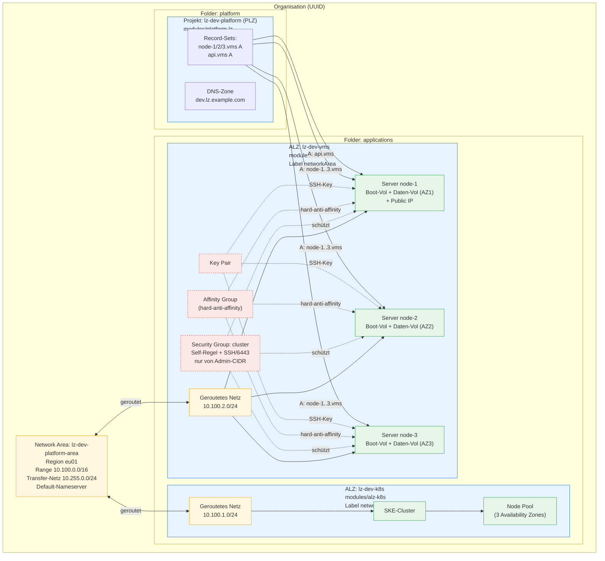

# Architektur

Die STACKIT Landing Zone gliedert sich in eine Organisation mit zwei Foldern: `platform`
(Platform Landing Zone, PLZ) und `applications` (zwei Application Landing Zones, ALZ).
Die PLZ stellt eine organisationsweite Network Area sowie die DNS-Zone bereit, an die sich
die Netze der ALZ `lz-dev-k8s` (SKE) und `lz-dev-vms` (3 selbst betriebene Cluster-Nodes)
per Routing anschließen.

### Legende

- **Folder → Projekt**: Durch Verschachtelung dargestellt – `platform` enthält das Projekt
  `lz-dev-platform`, `applications` enthält die Projekte der beiden ALZ.
- **Network Area ↔ ALZ-Netze** (durchgezogene Doppelpfeile, `geroutet`): Die Network Area
  `lz-dev-platform-area` wird auf Organisationsebene verwaltet und per Label `networkArea`
  an beide Application Landing Zones angehängt.
- **DNS-Records** (durchgezogene Pfeile): zeigen auf die privaten IPs von `node-1`–`node-3`
  (`node-1/2/3.vms`) bzw. auf die Public IP von `node-1` (`api.vms`).
- **Gepunktete Pfeile**: Richtlinien/Ressourcen, die auf die Server wirken – Security Group
  (Self-Regel für Cluster-internen Verkehr, SSH/6443 nur von Admin-CIDR), Affinity Group
  (harte Anti-Affinität je Node) und Key Pair (SSH-Zugang).
- **Terraform-Module**: `modules/platform-lz` (PLZ: Network Area + DNS), `modules/alz-k8s`
  (SKE-Cluster), `modules/alz-vms` (3 Server-Nodes mit Netz, Security Group, Affinity Group,
  Key Pair).
